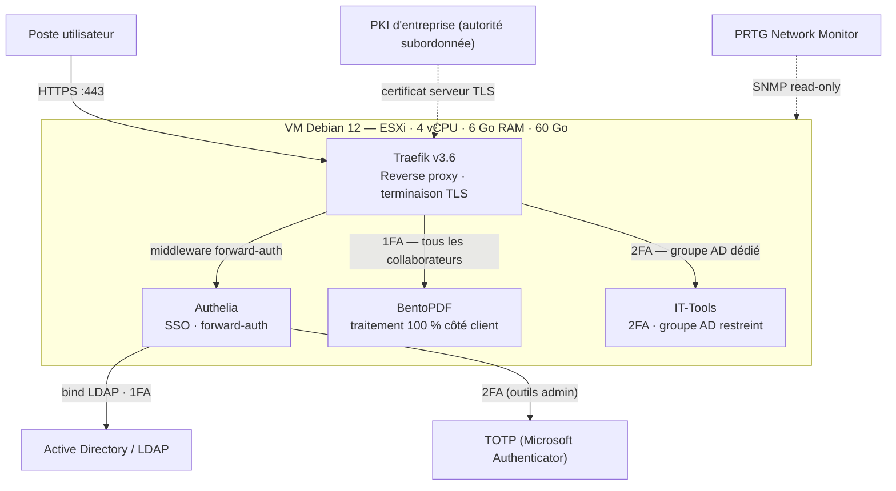

# pdf-souverain
Plateforme d'édition PDF 100 % souveraine et auto-hébergée — BentoPDF derrière Traefik (TLS) et Authelia (SSO Active Directory + MFA). Zéro exfiltration de données (traitement côté client, validé en mode avion), zéro licence. Projet de fin d'études AIS.

# 🔐 Plateforme PDF Souveraine — Traefik × Authelia × BentoPDF

> Remplacer les outils d'édition PDF en ligne (Shadow IT) bloqués par le filtrage de sécurité par une alternative **on-premise, chiffrée, authentifiée en SSO et sans coût de licence**.  
> Projet de fin d'études — Administrateur d'Infrastructures Sécurisées (AIS, niveau 6), réalisé en alternance au sein de la DSI d'un groupe logistique français.

 🎓 Projet de fin d'études AIS — 2025/2026  
 🖥️ Stack : **Debian 12 · Docker · Traefik v3.6 · Authelia · BentoPDF**  
 🔒 Accès : **SSO annuaire LDAP/AD + MFA TOTP** — chiffrement TLS via PKI interne  
 🚫 **Zéro exfiltration de données** : traitement 100 % côté client (validé en mode avion)  
 💰 **0 € de licence** : \~96 % d'économie sur 3 ans vs licences propriétaires

---

## 📋 Sommaire

- [Contexte &amp; problématique](#-contexte--problématique)
- [Objectifs](#-objectifs)
- [Architecture](#-architecture)
- [Choix techniques](#-choix-techniques)
- [Mise en œuvre](#-mise-en-œuvre)
- [Validation &amp; tests](#-validation--tests)
- [Sécurité — bonnes pratiques](#-sécurité--bonnes-pratiques)
- [Bilan](#-bilan)
- [Perspectives](#-perspectives)
- [Auteur](#-auteur)

---

## 📌 Contexte &amp; problématique

Le déploiement d'une solution de sécurisation des flux Web (Zero Trust, DLP, mise en conformité RGPD) a bloqué les outils d'édition PDF en ligne utilisés par les collaborateurs — un blocage légitime : ces services copiaient des documents sensibles vers des serveurs tiers situés hors de l'Union européenne.

Deux problèmes émergent alors :

1. **Un impact financier élevé** : l'alternative propriétaire standard coûte 23,99 € HT/mois et par utilisateur, soit un budget DSI intenable à l'échelle de l'entreprise.
2. **Un risque critique pour les données sensibles** : RH et comptabilité ont un besoin quotidien d'édition PDF sur des documents hautement confidentiels — l'utilisation de services Cloud tiers y est une faille RGPD majeure.

**La solution retenue** : une instance **BentoPDF auto-hébergée** sur une VM Debian interne, sécurisée par le reverse proxy **Traefik** (TLS via PKI d'entreprise) et une authentification **Authelia** branchée sur l'annuaire **LDAP/Active Directory**.

### 💰 Analyse du coût

| Solution            | Modèle de coût          | 1 utilisateur (€/an) | 50 utilisateurs (€/an) | Sur 3 ans (50 utilisateurs) |
| ------------------- | ----------------------- | --------------------: | ----------------------: | ---------------------------: |
| Adobe Acrobat Pro   | Licence par utilisateur | 266 €                | 13 300 €               | **39 900 €**                |
| Foxit PDF           | Licence par utilisateur | 160 €                | 8 000 €                | **24 000 €**                |
| BentoPDF on-premise | Coût serveur fixe       | \~500 €              | \~500 €                | **\~1 500 €**               |

> Aucun investissement matériel supplémentaire : la stack s'appuie sur l'infrastructure de virtualisation VMware ESXi existante. Environ **66 h** de travail ont été nécessaires de bout en bout (étude, déploiement, sécurité, tests, documentation).

---

## 🎯 Objectifs

- **Souveraineté des données** : les documents ne quittent jamais l'infrastructure de l'entreprise — zéro fuite vers des serveurs tiers.
- **Accès strictement contrôlé** : SSO branché sur l'annuaire de l'entreprise, filtrage par groupes AD, MFA sur les outils d'administration. Pas question de « simplement ouvrir un service sur le réseau ».
- **Intégrité et chiffrement des flux** : accès exclusivement en HTTPS avec un certificat émis par la PKI d'entreprise — aucune alerte de sécurité navigateur, aucune action manuelle pour l'utilisateur.
- **Coût maîtrisé** : uniquement de l'open-source, zéro licence.

---

## 🏗️ Architecture

Points clés de l'urbanisation :

- **Point d'entrée unique** : seuls les ports 80/443 sont exposés ; Traefik route le trafic vers les ports internes des conteneurs, invisibles depuis l'extérieur.
- **Découverte dynamique** : routage piloté par les labels Docker (aucune configuration manuelle).
- **Terminaison TLS** : Traefik présente le certificat serveur émis par l'autorité de certification de l'entreprise, déjà reconnue comme de confiance par les postes clients.
- **Forward Auth** : aucune requête n'atteint les applications avant validation par Authelia (Zero Trust).

---

## ⚖️ Choix techniques

### Application PDF : Stirling-PDF vs BentoPDF

Deux solutions open-source ont été déployées en POC via Docker :

| Critère                                  | Stirling-PDF                                           | BentoPDF                                    |
| ---------------------------------------- | ------------------------------------------------------ | ------------------------------------------- |
| Fonctionnalités                          | Très exhaustives (signature, cachets, édition directe) | Essentielles, interface épurée et intuitive |
| Fichiers volumineux (test sur 200 pages) | Latences importantes                                   | Robuste et fluide                           |
| Conversion PDF → Word (.docx)            | Défauts de mise en page (décalages)                    | Conversions fidèles                         |
| **Verdict**                              | ❌                                                      | ✅ **Retenu**                                |

### Authentification : Casdoor vs TinyAuth vs Authelia

| Solution     | Points forts                                                                 | Limites                                            | Verdict      |
| ------------ | ---------------------------------------------------------------------------- | -------------------------------------------------- | ------------ |
| Casdoor      | GUI très riche, personnalisation poussée                                     | Trop gourmande en ressources pour une VM optimisée | ❌            |
| TinyAuth     | Ultra-légère, quasi invisible                                                | Pas de gestion fine des groupes LDAP/AD            | ❌            |
| **Authelia** | Intégration native Traefik, LDAP/LDAPS, filtrage par groupes AD, très légère | Configuration en fichiers YAML uniquement          | ✅ **Retenu** |

> L'absence d'interface de gestion graphique d'Authelia est un **atout sécurité** : elle réduit la surface d'attaque de la couche d'authentification.

---

## 🚀 Mise en œuvre

### 1. Préparation de l'hôte Debian (VMware ESXi)

- VM dédiée **Debian 12** : 4 vCPU · 6 Go RAM · 60 Go de stockage.
- Configuration réseau statique + résolution DNS interne (nécessaire pour joindre l'annuaire LDAP).
- Durcissement du système : compte administrateur dédié + sudoers, root désactivé pour les connexions distantes, `apt update && apt upgrade`.
- Durcissement SSH (`/etc/ssh/sshd_config`) :

| Directive                                     | Valeur                 | Objectif                              |
| --------------------------------------------- | ---------------------- | ------------------------------------- |
| `Port`                                        | modifié (non standard) | Éviter le scan automatisé             |
| `PermitRootLogin`                             | `no`                   | Aucune connexion root                 |
| `AllowUsers`                                  | admin uniquement       | Restriction des comptes               |
| `MaxAuthTries` / `MaxSessions`                | `3` / `2`              | Anti brute-force, sessions maîtrisées |
| `PubkeyAuthentication`                        | `yes`                  | Authentification par clés             |
| `PermitEmptyPasswords`                        | `no`                   | Aucun mot de passe vide               |
| `ClientAliveInterval` / `ClientAliveCountMax` | `300` / `2`            | Fermeture des sessions inactives      |
| `PermitTunnel`                                | `no`                   | Interdiction des tunnels VPN          |

- Installation de **Docker + Docker Compose** pour l'isolation des applicatifs.

### 2. Traefik — reverse proxy durci

- Image **figée sur une version majeure** (traefik:v3.6) pour la stabilité.
- **Exposition réseau minimale** : uniquement 80/443 ; aucun port d'administration exposé.
- **Moindre privilège** : tous les volumes et le socket Docker montés en lecture seule (`:ro`) — en cas de compromission du conteneur, la configuration est intouchable (mitigation Docker Escape).
- **Redirection HTTPS globale** : aucun flux non chiffré toléré.
- `exposedByDefault: false` : chaque application doit explicitement demander son exposition via label — rien n'est publié par accident.
- **Dashboard sécurisé par double verrou** : mode `insecure` désactivé + accès conditionné au portail SSO (middleware Authelia) pour les seuls administrateurs de l'annuaire.

### 3. Authelia — SSO branché sur l'annuaire

- **Forward Auth** avec Traefik : toute requête est interceptée et validée avant d'atteindre l'application.
- **Centralisation des identités** : interconnexion directe avec l'Active Directory (pas de comptes locaux redondants) — les utilisateurs gardent leurs identifiants de session Windows habituels.
- **Politique Zero Trust** : `default_policy: deny`, tout flux non explicitement déclaré est banni.
- **Filtrage granulaire par groupes AD** :
  - **1FA** (identifiants AD) pour les outils de productivité quotidiens ;
  - **2FA TOTP** (Microsoft Authenticator, code à 30 s) pour les outils d'administration — réservés aux membres d'un groupe de sécurité dédié.
- **Compte de service au moindre privilège** (recommandations ANSSI &amp; NIST) : lecture seule sur l'annuaire, aucun droit d'administration, aucun login interactif, secret de 32 caractères généré manuellement (pas de compatibilité gMSA).
- **Docker Secrets** : aucune donnée sensible en clair — mots de passe et clés de session lus depuis `/run/secrets/`, indépendants du conteneur et non lisibles via `docker inspect`.

### 4. BentoPDF — application invisible de l'extérieur

- Aucune publication de ports sur l'hôte : le conteneur est joignable uniquement via Traefik sur le réseau Docker `frontend` isolé.
- Routage, TLS et verrou d'authentification entièrement pilotés par labels.
- `restart: unless-stopped` : reprise automatique après redémarrage de la VM ou du daemon Docker.

### 5. Supervision — SNMP + PRTG

- Agent SNMP configuré en **communauté read-only** (aucune modification possible du serveur supervisé), écoute UDP 161.
- Capteurs PRTG : CPU, RAM, swap, espace disque, uptime, ping, disponibilité HTTP/HTTPS et **expiration du certificat TLS** (anticipation des renouvellements, contrôle de la chaîne de confiance et du caractère non auto-signé).

---

## ✅ Validation &amp; tests

| #   | Test                                                      | Résultat attendu                                                           | Statut |
| --- | --------------------------------------------------------- | -------------------------------------------------------------------------- | ------ |
| 01  | Accès en HTTP non sécurisé                                | Redirection forcée en HTTPS puis renvoi vers le portail SSO                | ✅ OK   |
| 02  | Authentification avec les identifiants de session Windows | Identité validée auprès de l'Active Directory, accès à l'application       | ✅ OK   |
| 03  | Traitement PDF (import, modification, téléchargement)     | Traitement local, rapide, sans décalage de mise en page                    | ✅ OK   |
| 04  | Accès à un outil technique admin                          | 2FA TOTP exigée + refus si l'utilisateur n'est pas dans le groupe AD dédié | ✅ OK   |

### 🔬 Audit d'étanchéité (DevTools — onglet Network)

Comparaison des flux réseau avec un document témoin non sensible :

- **Service Cloud externe** : multiples requêtes `POST` externes (upload, tracking publicitaire, analytics) → le document est copié sur des serveurs tiers dont l'entreprise ne maîtrise ni la localisation ni la rétention. C'est précisément ce flux qui déclenchait les alertes de sécurité.
- **Instance BentoPDF locale** : uniquement des requêtes `GET` locales (chargement des composants dans le cache du navigateur) — **aucune requête sortante**.
- **Test ultime — mode avion** : une fois l'interface chargée, le traitement complet du PDF a été exécuté **machine cliente déconnectée de tout réseau**. Résultat : succès complet. Preuve que les documents ne quittent jamais le poste.

---

## 🔐 Sécurité — bonnes pratiques

| Principe                      | Mise en œuvre                                                                                                                         |
| ----------------------------- | ------------------------------------------------------------------------------------------------------------------------------------- |
| **Moindre privilège**         | Volumes et socket Docker en lecture seule · compte de service LDAP lecture seule sans login interactif · aucun port applicatif exposé |
| **Zero Trust**                | `default_policy: deny` — tout flux non déclaré est banni ; authentification préalable obligatoire (forward auth)                      |
| **Surface d'attaque réduite** | Pas de GUI sur la couche d'authentification · dashboard Traefik verrouillé par SSO · `exposedByDefault: false`                        |
| **Secrets externalisés**      | Docker Secrets + variables `_FILE` — aucune donnée sensible en clair dans la configuration                                            |
| **Chiffrement des flux**      | HTTPS exclusif, certificat émis par la PKI d'entreprise (chaîne de confiance déjà déployée sur les postes)                            |
| **Durcissement système**      | SSH durci (voir tableau), root désactivé, sudoers stricts, système à jour                                                             |
| **Souveraineté des données**  | Traitement 100 % côté client dans le navigateur — zéro exfiltration, conformité RGPD                                                  |

---

## 📈 Bilan

- ✅ **Conformité et souveraineté** : l'URL interne fait partie du périmètre de confiance — la faille initiale est définitivement colmatée, sans contournement de la politique de sécurité.
- ✅ **Productivité restaurée** : outil moderne (fusion, conversion, signature) accessible depuis le navigateur, SSO transparent avec les identifiants Windows → adoption immédiate, éradication du Shadow IT pour ce besoin.
- ✅ **Valorisation pour la DSI** : 0 € de licence, empreinte système minimale (une seule VM), déploiement et mises à jour conteneurisés sans interruption de service.

---

## 🔭 Perspectives

- [x] **IT-Tools sécurisé en 2FA** : dépassé le périmètre initial — l'outil, hors cahier des charges de départ, a été déployé et verrouillé pour les équipes IT et développeurs via la même stack.
- [ ] **Portail applicatif unique** : centraliser l'accès à tous les outils sur une seule page d'accueil (en cours d'évaluation).
- [ ] **IA générative locale** : héberger un modèle d'IA sur l'infrastructure pour assister les collaborateurs avec une souveraineté numérique absolue — dans l'esprit de ce projet, aucune donnée ne partirait vers des plateformes tierces.

---

## 👤 Auteur

**Romain Gambart** — Administrateur d'Infrastructures Sécurisées (AIS, niveau 6).  
Projet de fin d'études réalisé en alternance (2025/2026) — virtualisation, sécurité, open-source et souveraineté numérique.
